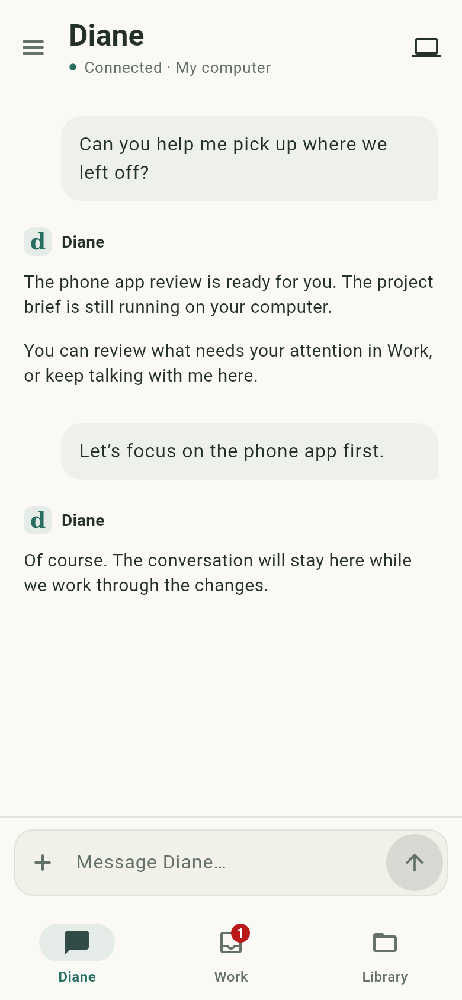
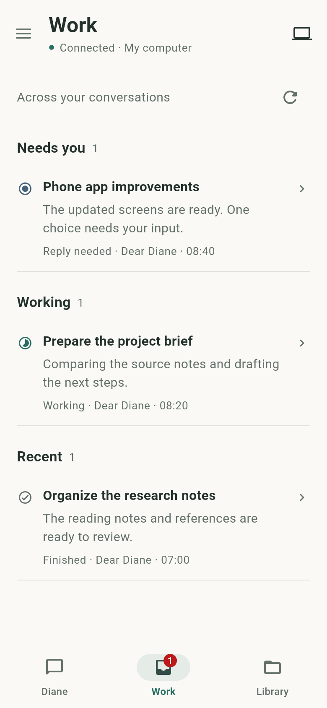
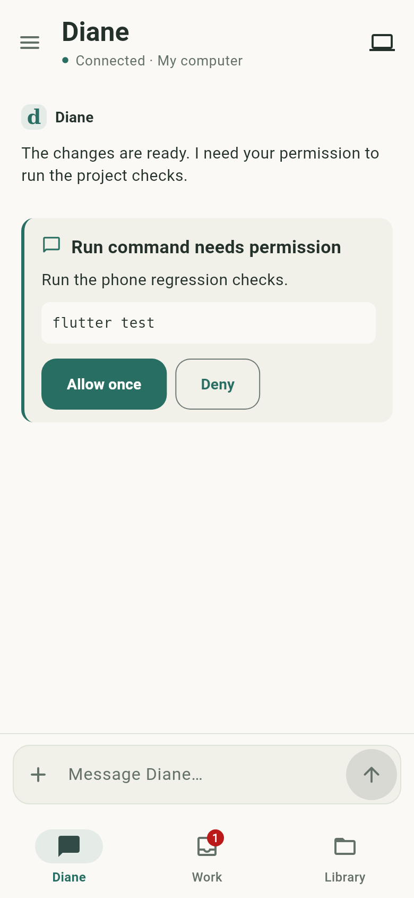

# Dear Diane Phone

The Flutter Android companion for talking to Diane, following work on your computer, and answering requests for help.

## Everyday use

- **Diane** keeps the conversation and composer close at hand. Return to your saved conversation, continue work, or steer a running request.
- **Work** brings decisions and interrupted work to the top, followed by running conversations and recent results. Tap a row to open its conversation.
- **Library** contains workspace files, notes, and outputs. Notes retain their editing and reading tools.

The computer indicator opens connection status and recovery actions. Detailed server, token, workspace, and VPN controls are available from connection settings. The interface follows the device's light or dark appearance.

Work rows reflect the existing session/task/run records. They do not yet represent a separate durable issue or commitment system.

## Where work happens

| Phone | Coordination backend | Execution computer |
| --- | --- | --- |
| Conversation, decisions, navigation, drafts, local outbox, reconnect | Canonical messages, durable receipts, duplicate protection, run routing, current state | Agent processes, native sessions, tools, browser, files, compute, outputs |

The backend and executor can run on the same remote computer. Phone continuations reuse the existing conversation's execution settings, including agent/account/model selection, workspace, and permission policy. New work requires a matching configured desktop workspace; the phone does not silently choose a different agent.

A conversation currently in desktop Plan mode stays in Plan mode. Starting or steering its execution requires reviewing that plan on the desktop first. The phone cannot widen that policy by sending a message or granting a tool permission.

## Delivery and recovery

The phone saves each outgoing action before sending it. A stable request ID stays with that action through retries and app restarts.

| State | Meaning |
| --- | --- |
| Saved on this phone | The request is in the local outbox; the computer has not acknowledged it. |
| Waiting for acknowledgement | A send is in progress. |
| Delivery unconfirmed | A response was lost or ambiguous. The phone checks the original receipt before retrying. |
| Accepted by computer | The backend has acknowledged the request. This does not mean the work is complete. |
| Check on your computer | The backend cannot safely determine whether an action took effect. Review the original work before taking another action. |
| Not delivered / no longer available | Read the reason and retry or return to the current decision when appropriate. |

Drafts, the selected conversation, and pending actions are scoped to the configured computer. Changing computers does not send the old computer's outbox to the new one. Reopening the app or restoring connectivity refreshes canonical state; updates from a previously selected conversation cannot overwrite the current view.

Questions and permission requests appear with their action context. A response whose outcome is uncertain is checked before any retry; an expired request is not automatically answered again. Stop remains targeted to the selected run and is shown as acknowledged only after the computer responds.

Execution continues on the computer while the phone is closed. The phone refreshes when active again; this version does not add background push notifications or remote screen sharing. An unavailable computer cannot execute locally queued work.

## Connect

1. Run a compatible Dear Diane backend on a computer reachable from your phone, using the existing authenticated remote/private-network setup.
2. Open the computer indicator, then connection settings. Enter the API address and access token.
3. Open an existing conversation to continue with its saved execution profile. For new work, configure the corresponding workspace on the desktop first.
4. Check Work for decisions and progress. Files and commands refer to the execution computer's filesystem.

The backend must include the `/api/phone` request/state APIs from the same change. An older backend cannot provide the new acknowledgement and recovery guarantees.

## Build and validate

Flutter 3.41.9 / Dart 3.11.5 matches the checked-in SDK constraint. From `mobile/`:

```sh
flutter pub get
flutter analyze
flutter test
flutter build apk --debug --dart-define=DAN_API_BASE=https://diane.example.com
```

The Android application ID remains `com.dan.dan_phone`, preserving installed-app compatibility. Source namespace: `com.diane.diane_phone`. Debug builds are for testing; production signing remains a separate release step.

Before installing over an existing app, retain its signing identity and check the paired backend version. Physical-device acceptance should cover app restart with a pending request, switching between Wi-Fi and cellular/VPN, a desktop-started native session, a pending decision, and Stop during active work.

### Verified source checks

On October 20: all 25 Flutter tests and 59 targeted backend regressions pass; Flutter analysis reports no issues. A clean Android ARM64 debug APK build succeeds. The tests cover delivery/restart recovery, storage failure, stale responses, scoped decisions and responsive layouts, including 360×640 with the keyboard open and text at 2×.

### UI previews

These renderings use the actual Flutter widgets and fictional content, not a connected phone or live account.

| Conversation | Work | Decision |
| --- | --- | --- |
|  |  |  |

[Offline recovery](docs/phone-offline.png) and [dark appearance](docs/phone-dark.png) are also included. To regenerate the five views:

```sh
flutter test tool/render_phone_preview_test.dart \
  --dart-define=PHONE_PREVIEW_DIR=/tmp/diane-phone-ui \
  --dart-define=PHONE_FONT_DIR=<flutter-sdk>/bin/cache/artifacts/material_fonts
```

Optional `PHONE_SERIF_FONT` and `PHONE_MONO_FONT` defines select local font files for the platform-family glyphs. The harness makes no backend requests.

## Optional private connection

An isolated Dear Diane WireGuard configuration can be supplied in connection settings or baked into a private test build:

```sh
flutter build apk --debug \
  --dart-define=DAN_API_BASE=https://diane.example.com \
  --dart-define=DAN_PHONE_WIREGUARD_CONFIG_B64=<base64-config>
```

Use a dedicated phone peer. A build containing its private VPN configuration is specific to that device and should not be distributed as a public artifact.

The app does not start its Android VPN tunnel automatically by default. `--dart-define=DAN_PHONE_WIREGUARD_AUTOSTART=true` is available for a dedicated build where automatic startup is intended. Configuration values in this guide are placeholders; use your own authenticated service and keep private VPN credentials out of shared builds and source control.
